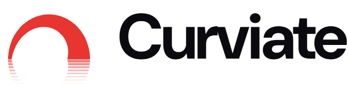

<p align="center">
  <picture>
    <source media="(prefers-color-scheme: dark)" srcset="assets/curviate-lockup-horizontal-dark.png">
    
  </picture>
</p>

<p align="center">
  <strong>Agent skills for LinkedIn work, driven through the Curviate CLI.</strong>
</p>

<p align="center">
  <a href="https://docs.curviate.com/reference/getting-started/plugin">Docs</a>
  &nbsp;&middot;&nbsp;
  <a href="https://curviate.com">Website</a>
  &nbsp;&middot;&nbsp;
  <a href="https://github.com/curviate/curviate-cli">CLI</a>
</p>

<br>

Curviate is a LinkedIn API for agents. This plugin teaches a coding agent how to drive it: which
command answers which task, the traps that cost a run, and the exit codes to branch on. Ask for the
outcome, and the matching skill loads on its own.

## Quickstart

**1. Add the plugin** in Claude Code:

```
/plugin marketplace add curviate/curviate-plugin
/plugin install curviate@curviate
```

**2. Install the CLI.** The plugin does not bundle it:

```bash
npm install -g @curviate/cli@next
```

**3. Ask your agent to set Curviate up.** The `curviate-quickstart` skill takes it from there:
authenticate this machine, connect a LinkedIn account, and prove the path works with a read. It
only reads: nothing is posted, sent or changed on LinkedIn.

> Set up Curviate and check that my LinkedIn account is connected.

## The skills

| Skill | Covers |
|---|---|
| `curviate` | Start here: which skill answers which task, and the rules that apply everywhere. |
| `curviate-quickstart` | The first run: install, authenticate, connect an account, prove it works. |
| `curviate-accounts` | Connected Accounts, health, limits, warm-up, Active hours; Mailboxes and their safe connect; Teams, roles, seats, the Tier; Notifications; stored profiles. |
| `curviate-campaigns` | Campaigns and Sequences: build, preview, start, pause, edit; variants; email steps and the Lead check; Enrollments; events; Analytics. |
| `curviate-leads` | Leads, Lead lists, Tags, imports, enrichment, export, the Do-not-contact list. |
| `curviate-find-emails` | Email addresses for Leads that lack one, through your own enrichment tool, one address per Lead. |
| `curviate-icp` | Scoring a Lead list against your ICP with your own model, one Tag per band. |
| `curviate-email-tools` | Handing Leads to an external email tool and taking its answers back, through a Recipe. |
| `curviate-intros` | A warm introduction to a Lead through someone your Team already knows. |
| `curviate-voice` | Voice note steps in a Campaign, in the Account's own recorded or cloned voice. |
| `curviate-profile` | Member profiles, company pages, filter-id resolution, retrieval mode. |
| `curviate-search` | People, companies, posts, jobs, service providers and groups. |
| `curviate-inbox` | Chats, messages, voice notes, InMail, company-page inboxes, message events. |
| `curviate-unibox` | Cross-Account reply triage: unread chats, read and unread as a hand-off, origin, Sync full inbox and Sync now, `chat.updated`. |
| `curviate-engage` | Posts, comments, reactions, the home feed and notifications, and Drafts you can schedule. |
| `curviate-network` | Connection invitations, follows, followers, the synced Network. |
| `curviate-jobs` | Job postings, budgets, publishing and applicants. |
| `curviate-premium` | Sales Navigator and Recruiter, and what can refuse them. |

## Other agents

The skills are plain Markdown with a short frontmatter block, under
[`curviate/skills/`](./curviate/skills/). Load them the way your agent loads instructions, and start
it on `curviate-quickstart`. Agents that discover skills over HTTP can read the published catalog
at <https://docs.curviate.com/.well-known/skills/index.json>.

## Learn more

- [Curviate plugin](https://docs.curviate.com/reference/getting-started/plugin): how the skills relate to the CLI, and the catalog
- [CLI reference](https://docs.curviate.com/reference/cli/setup-and-doctor): every command, flag and exit code
- [Install the CLI from an agent session](https://curviate.com/INSTALL.md)

## Contributing

The skills are hand-written and carry judgement, not reference: flags and limits live in the CLI's `--help`. Every
`curviate` command a skill names is checked against the CLI commit pinned in [`package.json`](./package.json), and every
JSON example against that CLI's `campaign lint`.

```bash
CURVIATE_CLI_BIN=<built cli.js> npm run check   # copy, then every command, flag, Sequence example and link
npm test                                        # the check's own planted-defect rows
```

## License

MIT. See [LICENSE](./LICENSE).
